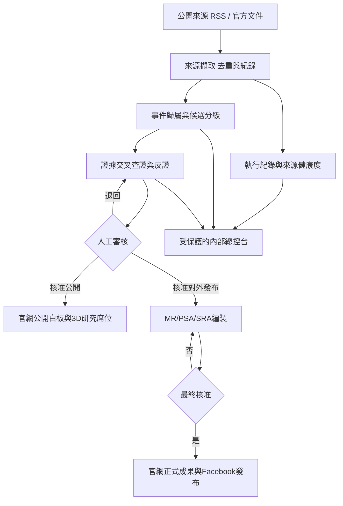

# APSS AI 虛擬研究室：系統架構草案 v1.0

- 文件類型：產品／技術架構草案；**不是已部署軟體，不代表四項 ChatGPT MR 已介接**。
- 擬定日期：2026-11-01（Asia/Taipei）
- 規劃標的：APSS Virtual Research Studio v0.4 及後續階段
- 編製原則：保有 MR 四項獨立性、證據至上、人工最終核准、公私分流、實際監測與示範動畫分離。

## 1. 系統使命

建立一套供亞太安全與戰略研究獨立工作室（APSS）使用的研究資訊流程：`公開來源蒐集 → 去重與分類 → 證據查核 → A/B/C 態勢建議 → 人工審核 → MR／PSA／SRA 等研究產出 → 官網／Facebook 發布`。把工作流程映射到四個 3D 研究席位；貓狗及員工休息動作另屬純視覺情境。

## 2. 平台與責任界面

| 平台 | 角色 | 存取政策 | 備註 |
| --- | --- | --- | --- |
| APSS 官網 `https://www.apss-tw.workers.dev/` | 機構公開入口、公開情勢總覽、正式成果索引 | 公開 | 不要直接暴露尚未核對或未公開的資料 |
| AI 辦公室 `https://apss-netizen.github.io/apss-virtual-research-studio/` | 3D 情境、各席位公開可展示的摘要／作業示範 | 公開 | GitHub Pages 不可充當私密研究後端 |
| 內部研究總控台（**待建**） | 來源全文或摘錄、證據、初判、待審查、通知、履歷 | 授權存取 | 建議 Cloudflare Worker + Access + D1 或同等方案 |
| Facebook APSS 專頁 | 研究成果的對外發布、圖卡、Reels、社群互動 | 公開 | 初期人工發布；未授權不自動發文 |
| GitHub Actions | 既有公開 RSS 線索蒐集／網站發布程序 | 後端執行與記錄 | 排程可能延遲或漏跑；不能作為唯一預警保障 |
| AI 模型 API（**尚未介接**） | 候選事件歸類、證據問題清單、分級建議、草稿 | 安全後端 | API 金鑰不得出現在公開儲存庫或網頁 |
| ChatGPT 中既有四項 MR 自動化 | 既有獨立長期監測 | ChatGPT 既有流程 | 不假定有可讀取執行紀錄、通知或聊天內容的直接 API |

### 系統邊界

APSS 官網的「大白板」應分成 **公開摘要白板**（經核可資訊）和 **內部研究戰情板**（未確認事項、研究假設、通知與草稿）；不能因都叫「白板」就共用公開權限。可考慮受 Cloudflare Access 保護的獨立應用／網域／路由，而非只靠前端隱藏按鈕。

## 3. 四項長期監測：固定、獨立

1. **MR-01 遠東暨西太平洋戰略態勢觀察**：軍事／安全／外交／經貿（含中國大陸與有證據的跨區域連動）。
2. **MR-02 中東／南亞地區輿情追蹤**：區域安全、外交、能源航道、集體防衛制度與政策落地。
3. **MR-03 跨區域武裝衝突連動觀察**：不是新聞熱度榜；強調來源戰場 A → 傳導機制 X → 接收場域 B，區分單向／雙向與證據級別。
4. **MR-04 人工智慧發展、跨域應用、治理與戰略影響觀察**：全球全領域技術、跨平台整合、民用／軍用、治理與政策競爭。

同一事件可對應複數 MR（primary_mr + related_mrs），保留跨項關聯，但每項有自己的基準線、監測紀錄及通知規則。

## 4. 判定邏輯：不可混淆的三個軸

### 4.1 態勢等級 `assessment_tier`

| 值 | 定義 | 使用方式 |
| --- | --- | --- |
| A | 具可核實的重大結構性變化或高戰略影響 | 優先人工複核；確認後即報 |
| B | 異常活動、可辨識政策／資源／行為變化，或形成中的趨勢訊號 | 優先人工複核；依證據即報 |
| C | 例行活動或基準線資料點 | 累積時間序列；同類事件原則每三個月彙整 |
| 待判 | 證據不足，尚不能合理判斷態勢等級 | 不為了湊級別強行指定 A/B/C |

以上為 APSS 的研究價值與態勢級別，**不是**事件真偽程度，不是 MR 文件類型，也不是新聞篇數分數。MR-03 額外附傳導鏈成熟度 `L1/L2/L3`，不得把跨戰區同時發生直接推論成因果。

### 4.2 證據狀態 `evidence_status`

`已確認／高度可能／疑似／未證實`；另保留官方聲稱、可信媒體報導、可核對影像、推論與反證。對外發布需明示證據限制。「未公開」不代表「未發生」，「疑似」也不代表「已證實」。

### 4.3 編輯／發布狀態 `review_status`

`新線索 → 待補證 → AI 建議已產生 → 人工審核中 → 已核准 → 已發布／退回／封存`。AI 的等級建議寫入 `suggested_tier`；只有人工確認可寫入 `confirmed_tier`（或使用授權人員核可的制度），並留下操作者、時間與理由。

## 5. 來源資料格式與可追溯性

每個事件卡至少具備：

- `event_id`、`title`、`source_url`、`publisher`、`source_type`、`published_at`、`observed_at`、`collected_at`；原文連結與時區不得丟失。
- `primary_mr`、`related_mrs`、事件類型、地區、主要行為者；保留同一事件多來源去重及來源差異。
- `suggested_tier`、`confirmed_tier`、`evidence_status`、`evidence_notes`、`alternative_explanations`、`counterevidence`、`next_check`。
- `review_status`、`reviewer`、`reviewed_at`、`public_approved`、`published_channels`。
- `workflow_run_id`、`collection_success_count`、`collection_failure_count`、`last_success_at`，及來源錯誤摘要。

公開網頁只讀取**經審核准予公開**的欄位及資訊。不要把私人筆記、未公開研究材料或 API 金鑰打包到 GitHub Pages 的 `data/live.json`。

## 6. 監測健康度的四項獨立核對

1. **排程已啟用？** `is_enabled`。
2. **最近確實有執行？** `last_run_started_at`、`last_run_finished_at`、`last_run_status`。
3. **通知設定與實際送達？** `notification_enabled`、`last_notification_attempt_at`、`delivery_status`。
4. **A/B 新事件是否判定且通報？** `event_detected_at`、`alert_created_at`、`alert_delivery_status`、`acknowledged_at`。

缺任何一項資料應顯示「未介接／無法確認」，不可將綠燈誤報為整條監測與通報正常。網站 GitHub Actions 的蒐集紀錄**不能**冒充 ChatGPT 既有 MR 排程及通知紀錄。

## 7. 資料流程與責任權限

- OpenAI API 或同級模型：在取得憑證和預算同意後，從安全後端執行結構化建議；**不是**讓本對話裡的 ChatGPT 自動持續登入你的網站。
- Facebook 初期採「已核可文案→人工複製／發布」；未來若有 Meta API 權限再加一鍵草稿或發布。不得先假定 Facebook 專頁已有 API 權限。

## 8. 3D 辦公室顯示規則

每席上方：`MR 名稱｜最近取得時間｜線索數｜待核實數｜A/B/C 建議數｜人工核准數`。點擊席位進入對應列表；A/B 紅橘提示只代表**待人工處理優先順序**，顯示 `AI 建議` 或 `人工確認`。對外視圖不顯示未核准的敏感細節。

人物是否在座位、走動、喝咖啡、打盹、摸貓或遛狗屬 `visual_activity`，與 `actual_pipeline_status` 分離。不得從人物動畫推導蒐集是否成功。

寵物：**橘貓**會巡視、跳上空桌、打盹；**邊境牧羊犬**巡場、叼玩具、趴下、與橘貓互看或短暫追逐。互動應可關閉或減少動作，以免干擾儀表板閱讀。

## 9. 建議技術落地

- v0.4：沿用現有 GitHub Pages + GitHub Actions（公開 RSS 線索）及現有 Canvas 場景。先規範資料欄位與顯示邏輯，加入貓狗情境和更清楚的工作站 UI。
- v0.5：建立受保護的 Cloudflare Worker API + D1（或等效安全資料庫）記錄歷史、審核、權限及通知，官網公開摘要、私有總控台隔離。上線前須檢查現有官網 Worker 的路由與程式架構，避免覆寫既有網站。
- v0.6：OpenAI Responses API 或其他模型的候選分級／摘要／證據問題清單；每次提示版本、模型、來源、輸出與人工決定保留稽核紀錄。公開資料送交外部模型前確認資料治理。
- v0.7+：Facebook 發布流程（先人工、權限確認後再自動化）、可選擇 Three.js 完整 3D 重建。

## 10. 不能省略的驗收原則

- 四項 MR 長期監測彼此獨立；A/B/C 和證據程度分開；C 級季度聚類。
- 能區分「12 個成功取得 RSS 來源」與「每個 MR 產生的新聞線索數」。
- 一次來源失敗與一次工作成功需分別記錄；工作成功不得遮蔽個別來源失敗。
- 正式發布一定有人為授權；公開網站不含金鑰、非公開研究紀錄、未核實內部報告。
- 執行、通知及 A/B 新事件通報可分別追查；無資料時明確顯示無法確認。
- 貓狗動畫停用後，不影響新聞蒐集、人工審查或網站資料顯示。

## 11. 尚需實測／核對

目前可依使用者先前提供的 v0.2 成功蒐集畫面與 GitHub 工作流程規格來制定草案；本次未能直接讀取其 Cloudflare 官網與 Facebook 後台，因此不聲稱已檢查兩者權限或網站結構。部署前應先備份既有工作室官網及儲存庫版本，確認路由、Access、Facebook 管理角色、來源授權及資料保留政策。
